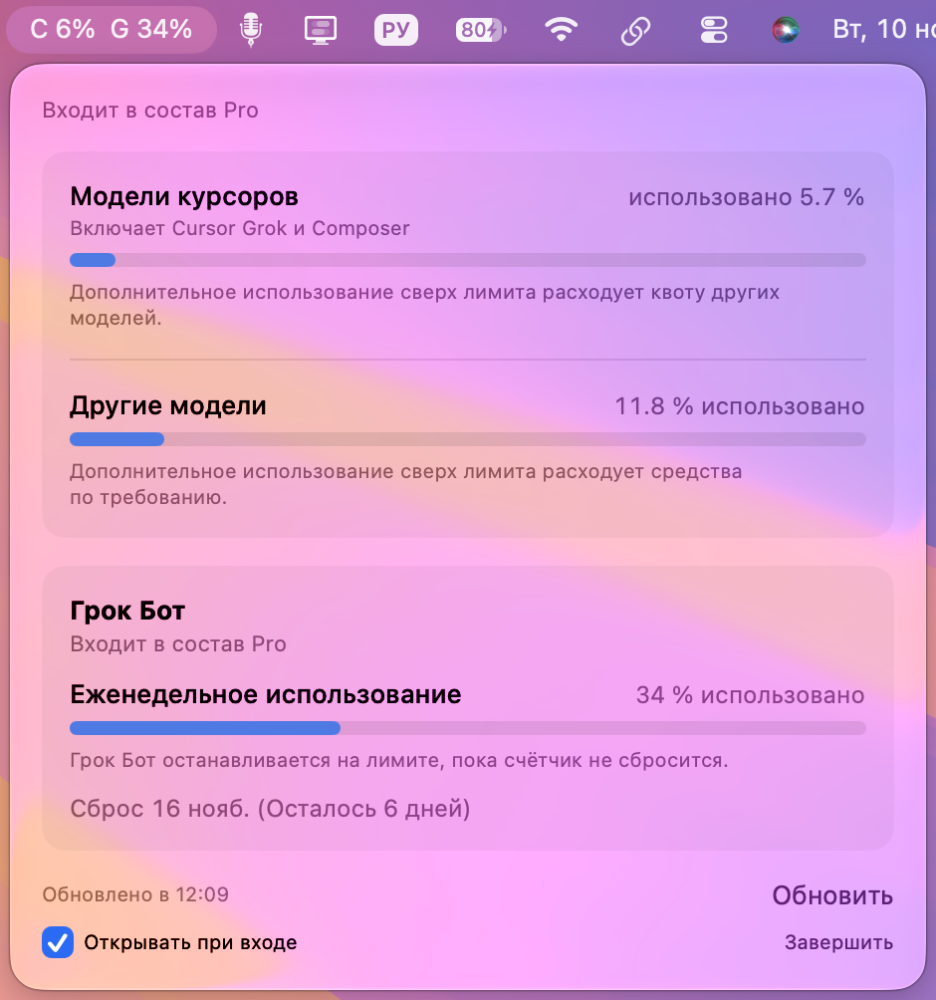

# Cursor Usage

Виджет для строки меню macOS. Он показывает, сколько лимитов Cursor уже израсходовано: модели Cursor, другие модели и еженедельный лимит Grok Bot с датой сброса.

Ничего устанавливать через мастер не нужно: скачали файл, перетащили приложение в «Программы» и запустили.



## Что нужно

- Компьютер Mac с macOS 14 Sonoma или новее
- Установленный [Cursor](https://cursor.com), в который вы вошли в свой аккаунт

У другого человека виджет покажет его собственные лимиты — после входа в его аккаунт Cursor.

## Как установить

### Через DMG (так проще)

1. Откройте раздел [Releases](https://github.com/zyamzin/cursor-usage-bar/releases/latest) и скачайте файл `Cursor-Usage.dmg`.
2. Откройте скачанный файл двойным щелчком.
3. Перетащите «Cursor Usage» в папку «Программы».
4. При первом запуске macOS может написать, что приложение не проверено Apple. Это нормально: у него нет подписи разработчика Apple.
   - Нажмите по приложению правой кнопкой мыши (или Control + щелчок) и выберите **«Открыть»**, затем подтвердите запуск.
   - Если система всё равно блокирует файл, откройте **Системные настройки → Конфиденциальность и безопасность** и нажмите **«Всё равно открыть»**.

Окна в Dock не будет. Приложение появляется текстом вроде `C 12%  G 34%` в строке меню вверху экрана.

### Через ZIP (запасной вариант)

1. Скачайте `Cursor-Usage.zip` из того же раздела [Releases](https://github.com/zyamzin/cursor-usage-bar/releases/latest).
2. Распакуйте архив двойным щелчком.
3. Перетащите «Cursor Usage» в «Программы».
4. Запустите так же: правый клик → **«Открыть»**.

## Автозапуск

В окне виджета есть галочка **«Открывать при входе»**. Если её включить, виджет будет запускаться вместе с компьютером.

## Как это работает и куда уходят данные

Приложение берёт уже сохранённую на этом компьютере сессию Cursor и запрашивает текущие лимиты только у серверов Cursor. Автору приложения, сайту zyamzin.ru и любым другим сервисам данные не отправляются.

Это неофициальный инструмент. Cursor может изменить формат данных, и тогда цифры могут отличаться от личного кабинета или виджет временно перестанет обновляться. Сверяйте показания с кабинетом Cursor.

## Сборка из исходников

Если хотите собрать приложение сами, нужны [Xcode Command Line Tools](https://developer.apple.com/xcode/resources/) и macOS 14 или новее:

```bash
git clone https://github.com/zyamzin/cursor-usage-bar.git
cd cursor-usage-bar
swift build -c release
```

Готовый файл лежит в `.build/release/CursorUsageBar` (или в `.build/apple/Products/Release/` при универсальной сборке). Его нужно положить в `Cursor Usage.app/Contents/MacOS/CursorUsage` и добавить `packaging/Info.plist` как `Contents/Info.plist`. Если `swift build` сообщает об ошибке XCBuild, соберите тот же исполняемый файл через `swiftc` из исходников в `Sources/CursorUsageBar` (нужны фреймворки AppKit, SwiftUI, ServiceManagement, Security и библиотека sqlite3). Затем можно подписать приложение своей подписью или одноразовой ad-hoc подписью:

```bash
codesign --force --deep --sign - "Cursor Usage.app"
```

## Дисклеймер

Инструмент бесплатный и распространяется как есть. Используйте на своё усмотрение и сверяйте данные с личным кабинетом Cursor. Автор не несёт ответственности за точность данных. Это неофициальный инструмент, он не связан с Cursor и Anysphere и ими не одобрен.

## Полезные инструменты для бизнеса

Больше полезных инструментов на моём сайте [zyamzin.ru](https://zyamzin.ru/tools.html?utm_source=github&utm_medium=readme&utm_campaign=cursor-usage-bar)

## Лицензия

MIT — см. [LICENSE](LICENSE). Автор: Евгений Зямзин.
